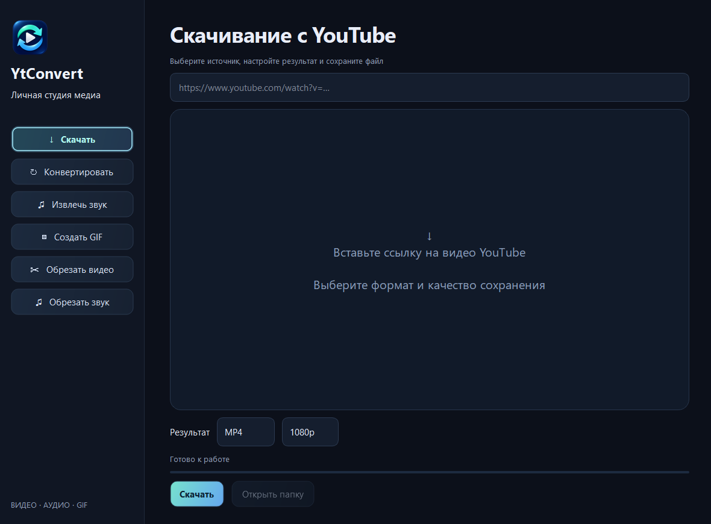

[Русский](README.md) | **English**

<p align="center"></p>

# YtConvert

A Windows desktop app for YouTube downloads, media conversion and trimming.
Dark interface, animated buttons and an integrated video and audio player.

[Download latest version](https://github.com/lolvk61/YtConvert/releases/latest) · [All releases](https://github.com/lolvk61/YtConvert/releases) · [MIT](LICENSE)



## Features

- Download individual YouTube videos at resolutions up to 2160p.
- Convert video to MP4, MKV, WebM, MOV or AVI.
- Extract audio as MP3, WAV, M4A, FLAC, OGG, Opus or AAC.
- Create GIFs with configurable width, frame rate and time range.
- Preview media, seek, mark start/end at the current position and play a selected segment.

## Installation

1. Download `YtConvert-v1.0.0-win-x64.zip` from Releases.
2. Extract the entire archive into a writable folder.
3. Run `YtConvert.exe`.

Requires Windows 10/11 x64. Python is included. On the first processing operation,
the app downloads FFmpeg and, if necessary, Deno into its local `bin` folder.
Internet access is required for initial setup and YouTube downloads.
Subsequent local conversion and trimming work offline.
You can also prepare these components with `install-tools.cmd`.
The interface is currently in Russian.

Additional download formats use transcoding. Available resolution depends on
the video. Live streams and playlists are excluded.
YouTube can restrict individual videos or change its delivery mechanisms.

## Development

Install Python 3.14 x64, then run these commands from the project folder.

```powershell
python -m pip install --target .deps -r requirements-build.txt
python app.py
python tools/build-release.py
```

The build produces a portable ZIP and `SHA256SUMS.txt` in `dist`.
Run `setup.cmd` to install source-run dependencies and external tools.

```powershell
Get-FileHash .\dist\YtConvert-v1.0.0-win-x64.zip -Algorithm SHA256
python app.py --self-test .verify/result.json
```

The self-test exercises every output format, decoded video frames, seeking and
fragment playback. Add `--network` to test downloading the public Blender
Big Buck Bunny video and converting it to MKV.

## License

[MIT](LICENSE), © 2026 lolvk61. Third-party components retain their respective
licenses. See [THIRD-PARTY-NOTICES.md](THIRD-PARTY-NOTICES.md).
The icon was created with ImageGen. Its prompt is in [assets/ICON-PROMPT.md](assets/ICON-PROMPT.md).
