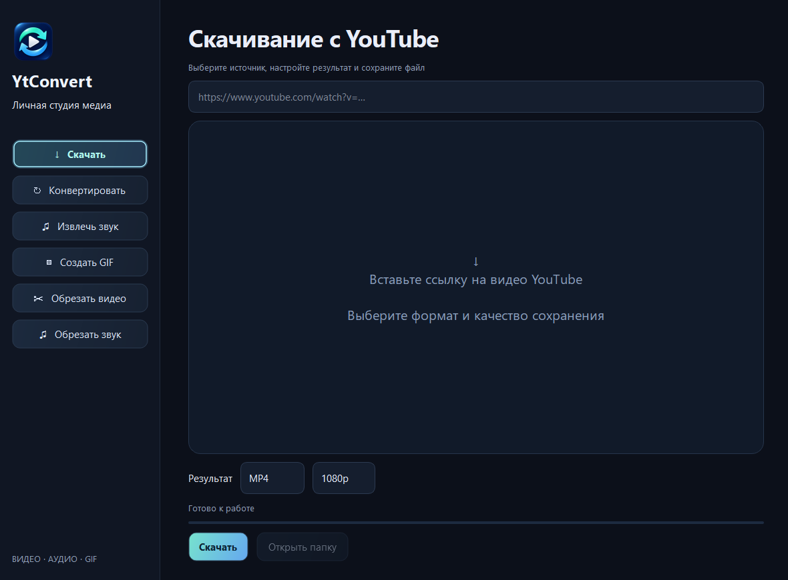
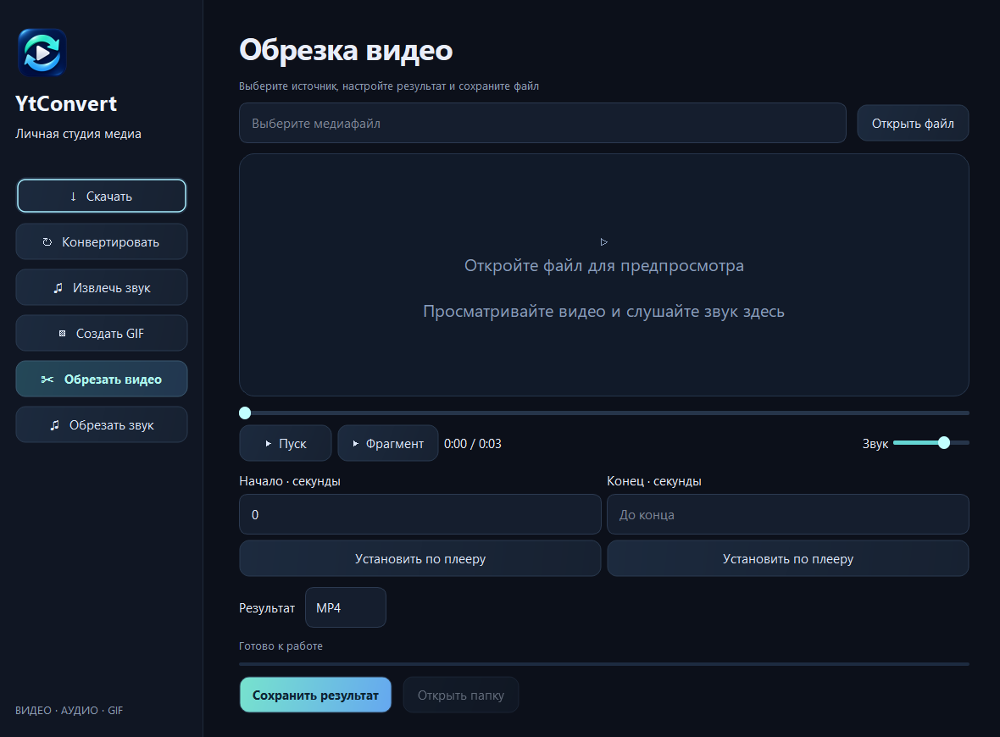

**Русский** | [English](README.en.md)

<p align="center"></p>

# YtConvert

Скачивание видео с **YouTube**, конвертация и обрезка медиа в приложении для **Windows**.
Тёмный интерфейс, переливающиеся кнопки и встроенный видео- и аудиоплеер.

[Скачать последнюю версию](https://github.com/lolvk61/YtConvert/releases/latest) · [Все релизы](https://github.com/lolvk61/YtConvert/releases) · [MIT](LICENSE)



## Возможности

- Скачивание отдельных видео YouTube с выбором качества до 2160p.
- Конвертация видео в MP4, MKV, WebM, MOV и AVI.
- Извлечение звука в MP3, WAV, M4A, FLAC, OGG, Opus и AAC.
- Создание GIF с выбором ширины, частоты кадров и фрагмента.
- Предпросмотр видео и прослушивание аудио с перемоткой и громкостью.
- Установка начала и конца обрезки по позиции плеера.
- Воспроизведение выделенного фрагмента с остановкой на его конце.
- Сохранение результата в отдельный файл.

## Установка

1. Скачайте `YtConvert-v1.0.0-win-x64.zip` из [Releases](https://github.com/lolvk61/YtConvert/releases/latest).
2. Распакуйте архив целиком в папку с правом записи.
3. Запустите `YtConvert.exe`.

Требуется **Windows 10/11, x64**. Python включён в portable-сборку.
При первой обработке программа скачает FFmpeg и, при необходимости, Deno в
подпапку `bin`. Для первоначальной подготовки компонентов и скачивания с YouTube
нужен интернет. После подготовки конвертация и обрезка локальных файлов работают
офлайн. Подготовить компоненты заранее можно через `install-tools.cmd`.

Дополнительные форматы скачивания создаются перекодированием. Доступное качество
зависит от исходного видео. Обрабатываются отдельные опубликованные ролики.
Прямые трансляции и плейлисты исключены.

## Обрезка видео и аудио



1. Откройте «Обрезать видео» или «Обрезать звук» и выберите файл.
2. Запустите воспроизведение или переместите ползунок.
3. Нажмите «Установить по плееру» под началом и концом.
4. Нажмите «Фрагмент», чтобы проверить выбранный диапазон.
5. Выберите формат и сохраните результат.

Границы также можно ввести вручную в секундах, как `01:30` или `00:01:30.500`.
Пустое поле конца означает обработку до конца файла.

## Если что-то не работает

| Ситуация | Что проверить |
| --- | --- |
| Не скачались компоненты | Проверьте интернет и право записи в папку программы. Повторите через `install-tools.cmd`. |
| YouTube не отдаёт видео | Проверьте доступность ролика и установите актуальную версию YtConvert. Ограничения сервиса могут влиять на загрузку. |
| Предпросмотр не открывается | Поддержка воспроизведения зависит от кодеков. Попробуйте конвертацию в MP4. |
| Границы отклонены | Начало должно быть раньше конца, обе границы — внутри длительности файла. |

## Сборка из исходников

Нужен **Python 3.14 x64** для Windows. Команды выполняются из папки проекта.

```powershell
python -m pip install --target .deps -r requirements-build.txt
python app.py
python tools/build-release.py
```

`setup.cmd` устанавливает зависимости для запуска исходников и внешние инструменты.
Скрипт сборки создаёт portable-архив и `SHA256SUMS.txt` в папке `dist`.

```powershell
Get-FileHash .\dist\YtConvert-v1.0.0-win-x64.zip -Algorithm SHA256
python app.py --self-test .verify/result.json
```

Самопроверка создаёт тестовый ролик, проверяет все выходные форматы, декодирование
кадров и воспроизведение фрагмента. С параметром `--network` она также скачивает
публичный ролик Big Buck Bunny студии Blender и преобразует его в MKV.

## Лицензия

[MIT](LICENSE), © 2026 lolvk61. Сторонние компоненты распространяются по собственным
лицензиям, перечисленным в [THIRD-PARTY-NOTICES.md](THIRD-PARTY-NOTICES.md).
Иконка создана через ImageGen. [Промпт и файлы](assets/ICON-PROMPT.md).
